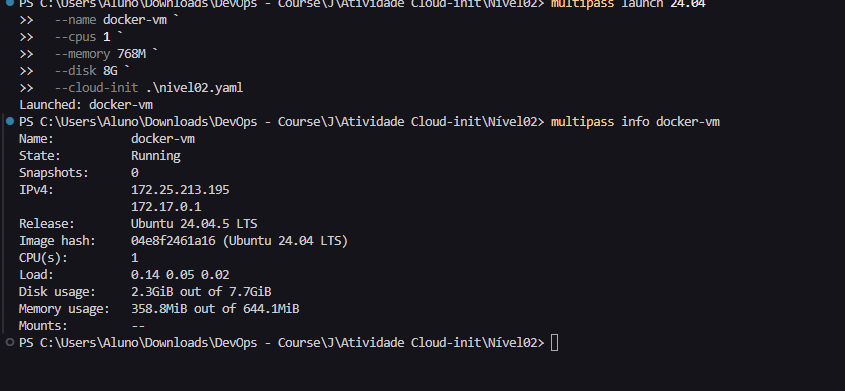
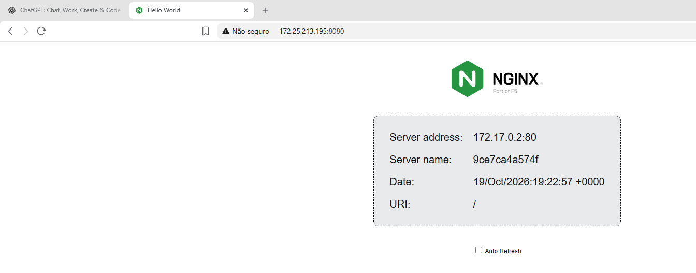

'Comandos para criar a máquina virtual com as configurações utilizando o Multipass:

'

'Comando para chegar as informações da máquina virtual utilizando o multipass:
    multipass info nginx-vm
'

